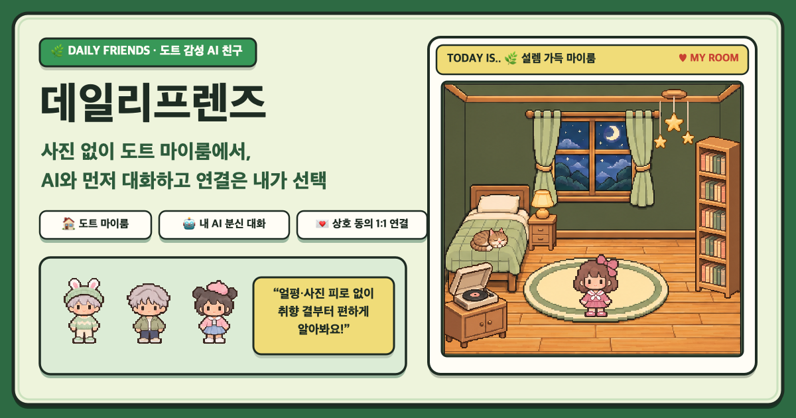
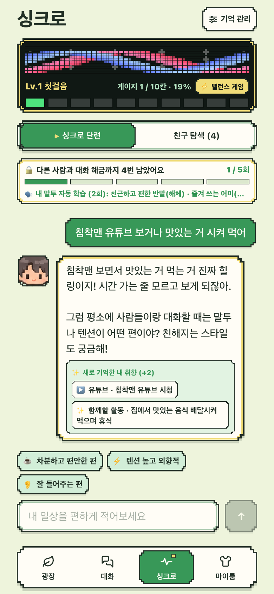
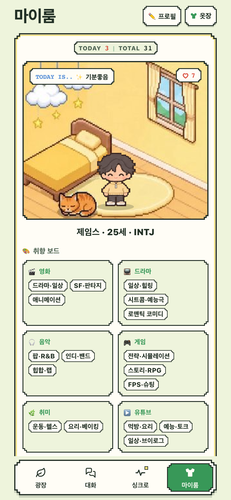
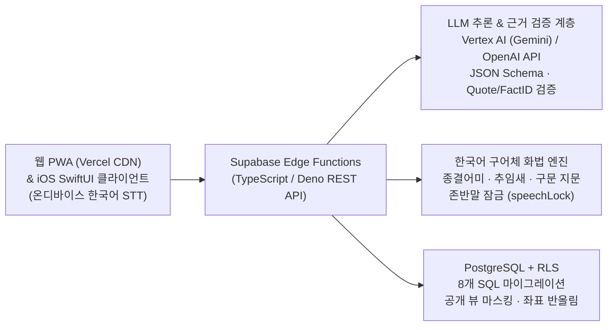

# 데일리 프렌즈 (Daily Friends) | 근거 추적형 AI 페르소나·기억 노트 웹 서비스

**한국어** | [English](daily-friends.md)

**역할:** 3인 팀 AI 파이프라인 · 백엔드/DB · 웹·iOS 기능 개발 주도<br>
**형태:** 3인 팀 공동 프로젝트 및 AI 보조 풀스택 개발 (`2026.10 – 현재`)<br>
**바로 보기:** [라이브 웹 서비스 (daily-friends-web.vercel.app)](https://daily-friends-web.vercel.app)



## 왜 만들었나

기존 소셜·매칭 서비스는 외모 사진과 짧은 자기소개에 의존해 대화 피로도가 높고, 반대로 단순 챗봇형 AI 페르소나는 사용자의 실제 취향·말투와 무관한 환각(Hallucination) 답변이나 과장된 호감 표현을 만들어내는 문제가 있었습니다.

**데일리 프렌즈**는 사진 없이 픽셀 아바타와 취향 노트로 자신을 표현하고, **사용자가 직접 승인한 사실과 대화에서 학습한 말투만 근거로 답하는 AI 분신**과 먼저 대화한 뒤 양쪽이 모두 원할 때만 1:1 대화가 열리는 구조로 설계했습니다. 운영 저장소와 인증 정보·사용자 데이터는 비공개로 유지하되, 이 문서에서 공개 가능한 아키텍처·AI 설계·보안 경계·검증 결과를 정리합니다.

## 화면 미리보기 (데모·테스트 데이터 기준)

| LLM 대화형 기억 추출 · 말투 자동 학습 (`싱크로`) | 픽셀 마이룸 · 6개 분야 취향 보드 (`마이룸`) |
| :---: | :---: |
|  |  |

## 시스템 아키텍처



## 핵심 설계와 공개 가능한 구현 내용

### 1. 환각 통제를 위한 JSON 스키마 · 원문 근거 검증 (Grounding)
- **기억 후보 추출 검증**: 사용자와의 대화 또는 iOS 온디바이스 한국어 음성 인식(`SFSpeechRecognizer`, 녹음 파일 미저장)에서 새 취향·에피소드를 추출할 때, 모델이 제안한 근거 인용구(`quote`)가 현재 사용자 발화 원문에 실제로 포함되는지 서버에서 검증합니다.
- **승인 사실 ID 기반 응답 강제**: 방문자와의 대화에서 AI가 사실 기반 답변(`kind = "facts"`)을 생성하려면 반드시 현재 승인된 프로필 목록에 존재하는 `factIDs`를 1개 이상 반환해야 하며, 존재하지 않는 ID나 근거 없는 추측은 파싱 단계에서 거부합니다.
- **프롬프트 인젝션 및 권한 경계 분리**: 사용자 입력과 프로필은 시스템 지침이 아닌 구조화된 JSON 데이터 필드로만 전달하며, 모르는 주제(`unknown`), 감정·약속·연결 동의 대리 결정(`humanDecision`), 비공개 정보 요구(`boundary`)를 상태 코드로 분리 처리합니다.

```json
{
  "text": "침착맨 보면서 맛있는 거 먹는 거 진짜 힐링이지! ...",
  "kind": "facts",
  "factIDs": ["approved-fact-uuid"],
  "synchroRate": 19.0,
  "learnedFacts": [
    { "kind": "favorite", "topic": "video", "value": "침착맨 유튜브 시청" },
    { "kind": "activity", "topic": "activities", "value": "집에서 맛있는 음식 배달시켜 먹으며 휴식" }
  ]
}
```

### 2. 한국어 구어체 화법 프로파일링 & 10대 기준 정량 채점
- **규칙 기반 구문 지문(Syntactic Fingerprint) + LLM 결합**: 발화에서 한국어 종결어미(`~해요`, `~거든요`, `~음/임`, `~어/야`), 추임새, 문장 평균 길이, 마침표 사용 습관을 추출해 프롬프트와 후처리에 반영합니다.
- **오염 방지 가드레일**: 추천 질문 칩 클릭 문장(`fromChip`)이나 1:1 인간 채팅 원문은 공개 AI 말투 학습 코퍼스에 유입되지 않도록 차단하고, 단문 입력으로 존댓말/반말이 뒤집히지 않도록 `speechLock`(`polite` / `casual` / `auto`)과 과도한 웃음 표기(`ㅋㅋ/ㅎㅎ`) 억제 후처리를 적용했습니다.
- **싱크로율 정량 채점**: 취향 분야 스펙트럼, 세부 장르, 구체 작품, 이유, 일상 에피소드, 고유 말버릇 등 10개 세부 기준을 합산해 진행 상태를 시각화했습니다.

### 3. 보안 · 개인정보 경계 및 운영 최적화 (`v27–v29` 전수 감사)
- **DB 뷰 마스킹 및 위치 정보 보호**: PostgreSQL 공개 뷰에서 `agePublic = false` 계정의 나이를 `NULL`로 마스킹하고 `speechProfile`·`likedByIDs` 내부 필드를 제거했으며, 위치 동의 시에도 좌표를 `0.1°` 단위로 반올림 노출(미동의 시 `NULL`)하도록 마이그레이션을 반영했습니다.
- **원문 비저장 및 양방향 동의 규칙**: 방문자-AI 대화 원문은 디스크에 남기지 않고 턴 수 카운터(`aiTurnCounts`)만 관리하며, 서버 단에서 양방향 AI 대화 3회 충족 및 상호 연결 의향(`web_intents`)을 확인해야만 1:1 인간 채팅을 허용합니다.
- **운영 안정화 및 비용 최적화**: 비밀키는 서버 환경변수로만 관리하도록 정리했고, 전체 테이블 풀스캔 제거, 정적 PNG 에셋의 Vercel CDN 직서빙 전환, 연락처 유출·유해 표현 필터 및 양방향 신고·차단 API를 적용했습니다.

## 자동화 검증 현황 (`2026-11-13` 기준)

| 검증 영역 | 실행 대상 | 통과 수 | 주요 검증 내용 |
| --- | --- | --- | --- |
| **iOS Core (Swift)** | `swift test` | **55개 통과** | 온보딩·복수 취향·기억 승인/철회·근거 ID 검사·연결/차단 규칙 |
| **Backend & DB (Node / PGlite)** | `cd backend && npm test` | **40개 통과** | 실제 SQL 마이그레이션 8종 순차 로드, RLS/권한 분리, 공개 뷰 마스킹, AI 구조화 출력·근거 거부 테스트 |
| **Web Client & Canvas (Node)** | `node --test web/*.test.mjs` | **31개 통과** | 36종 아바타·27,648개 방 조합 정수 픽셀 좌표, 모바일 UX·상태 정합성 회귀 테스트 |

## 내 역할과 기술 스택

- **주요 담당 영역**: 서비스 핵심 흐름 및 AI 파이프라인 설계, Vertex AI(Gemini)·OpenAI 구조화 응답 및 구어체 화법 엔진 구현, Supabase PostgreSQL 마이그레이션·Edge Functions REST API 구축, 보안·개인정보 전수 감사 조치, Vercel 프로덕션 배포 및 자동화 테스트 검증.
- **기술 스택**: TypeScript, Deno (Supabase Edge Functions), PostgreSQL (RLS·Views), Vertex AI (Gemini API), OpenAI API, Swift / SwiftUI (iOS 17+, `SFSpeechRecognizer`), HTML/CSS/JS PWA, Vercel, PGlite, Node `test`, `XCTest`.

## 공개 범위와 한계

- **비공개 영역**: 3인 팀 운영 저장소 소스 코드 전체, 서버 비밀키·OAuth 설정, 실제 참가자 데이터 및 내부 운영 로그는 보안과 개인정보 보호를 위해 비공개로 유지합니다.
- **공동 작업 및 AI 보조 개발 구분**: 본 프로젝트는 3인 팀 협업으로 진행되었으며(팀원들의 기획·피드백·코드 기여 포함), AI 코딩 도구를 활용한 보조 개발 과정을 거쳐 설계·감사·테스트로 품질을 검증했습니다.
- **검증 경계**: 웹 버전은 라이브 배포([daily-friends-web.vercel.app](https://daily-friends-web.vercel.app))를 완료했으나, iOS SwiftUI 앱은 Xcode 시뮬레이터 검증 단계이며 App Store·TestFlight 정식 출시는 아직 진행하지 않았습니다. 실측하지 않은 활성 사용자 수(MAU)나 전환율 지표는 제시하지 않습니다.

[전체 포트폴리오로 돌아가기](../README.ko.md)
