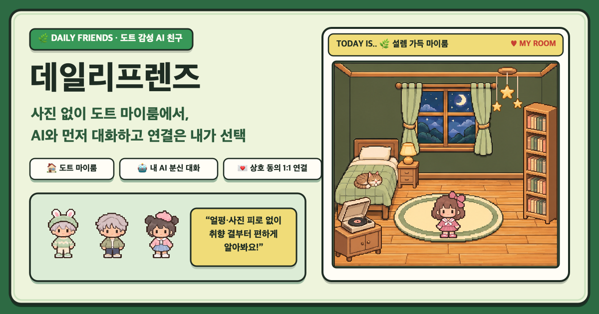
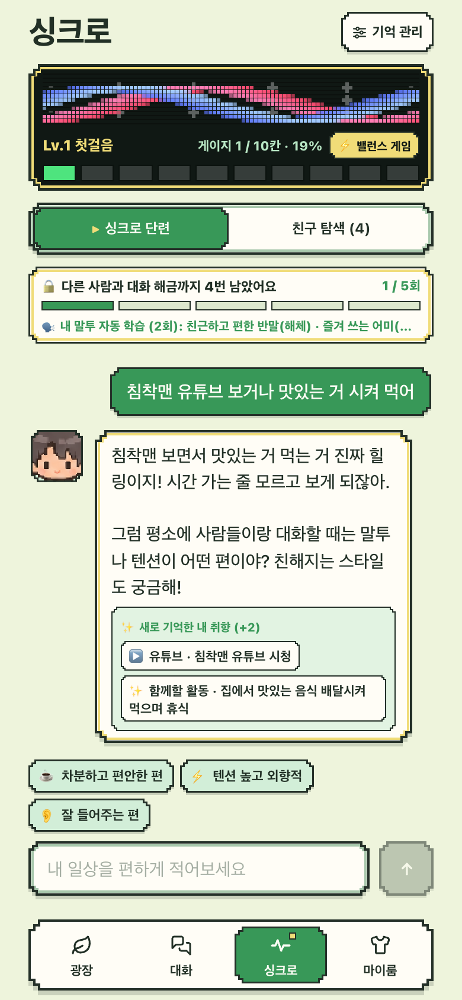
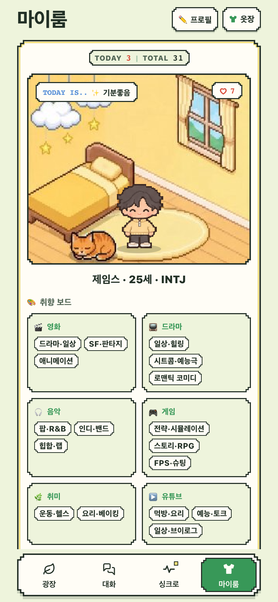
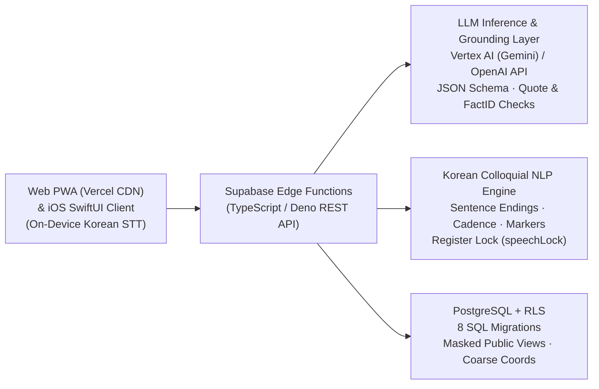

# Daily Friends | Grounded AI Persona & Memory-Note Web Service

[한국어](daily-friends.ko.md) | **English**

**Role:** AI Pipeline, Backend/DB, and Web/iOS Feature Lead (3-Person Team)<br>
**Format:** 3-person team product & AI-assisted full-stack engineering (`Oct 2026 – Present`)<br>
**Live Service:** [daily-friends-web.vercel.app](https://daily-friends-web.vercel.app)



## Problem & Motivation

Photo-first social apps create profile fatigue before two people ever discover shared tastes, while unconstrained persona chatbots frequently hallucinate personal facts, invent feelings, or leak private context.

**Daily Friends** introduces a pixel-avatar social flow where users first build a structured taste notebook and speak with each other's **fact-grounded AI persona**—opening 1:1 human chat only after both sides complete AI conversations and explicitly opt in. Because the operating repository contains team code, OAuth/infrastructure configuration, and live member data, the repository itself remains private while this case study documents the shareable architecture, AI grounding design, privacy audit, and automated test verification.

## Product Previews (Synthetic / Test Profile Data)

| Conversational LLM Memory Extraction & Speech Profiling | Pixel MyRoom & 6-Category Taste Board |
| :---: | :---: |
|  |  |

## System Architecture



## Shareable Engineering Highlights

### 1. Structured JSON Outputs & Hallucination Guardrails
- **Source-Quote Memory Verification**: When extracting new tastes or daily episodes from user chat or on-device Korean speech transcription (`SFSpeechRecognizer`, no raw audio saved), the server verifies that every candidate `quote` is an exact substring of the user's current utterance before offering it for user review.
- **Approved `factIDs` Attribution**: Any factual reply (`kind = "facts"`) must cite at least one UUID from the owner's currently approved profile facts; unapproved IDs or unsupported claims are rejected at parse time.
- **Data-vs-Instruction Separation**: Profile records and conversation turns are passed strictly as JSON data payloads, with explicit response states separating factual replies (`facts`), unknown topics (`unknown`), non-delegable human decisions (`humanDecision`), and privacy boundaries (`boundary`).

```json
{
  "text": "Relaxing with a favorite YouTube channel and good delivery food sounds great! ...",
  "kind": "facts",
  "factIDs": ["approved-fact-uuid"],
  "synchroRate": 19.0,
  "learnedFacts": [
    { "kind": "favorite", "topic": "video", "value": "Favorite YouTube channel" },
    { "kind": "activity", "topic": "activities", "value": "Ordering delivery food and relaxing at home" }
  ]
}
```

### 2. Korean Colloquial Syntactic Fingerprinting & 10-Criteria Scoring
- **Rule-Based NLP + Low-Latency LLM**: Extracts Korean sentence-ending distributions, discourse markers, average utterance length, and punctuation habits (`Syntactic Fingerprint`) to keep persona replies consistent with the owner's tone on top of Vertex AI (Gemini) JSON inference.
- **Anti-Contamination Controls**: Blocks suggested prompt chips (`fromChip`) and private 1:1 human chat text from polluting the public AI speech corpus, adds explicit `speechLock` (`polite` / `casual` / `auto`) to prevent short inputs from flipping formality, and suppresses repetitive laugh-marker spam.
- **10-Criteria Synchro Audit**: Scores persona completeness across 10 concrete dimensions (taste topic breadth, genres, named favorites, reasons, daily episodes, speech habits, activities, and conversational cadence).

### 3. Security, Privacy & Production Audit (`v27–v29`)
- **Database View Masking & Coarse Location**: Rebuilt PostgreSQL public views to mask `age` as `NULL` whenever `agePublic = false`, strip internal `speechProfile` and `likedByIDs` fields, and coarsen opted-in coordinates to `0.1°` (`NULL` when location consent is off).
- **Zero-Storage Visitor Transcripts & Mutual AI Gate**: Visitor AI chat text is not persisted on disk; only integer turn counters (`aiTurnCounts`) are updated, and the server enforces a 3-turn bidirectional AI chat requirement plus mutual `web_intents` before enabling 1:1 messaging.
- **Operational Hardening**: Migrated all API credentials strictly to server environment variables, eliminated full-table scans on persona updates, moved static PNG assets to Vercel CDN direct serving, and added server-side contact-leak detection and bidirectional report/block enforcement.

## Automated Verification (`2026-11-13` Snapshot)

| Layer | Command / Suite | Result | Verified Coverage |
| --- | --- | --- | --- |
| **iOS Core (Swift)** | `swift test` | **55 passed** | Onboarding, multi-topic tastes, memory approval/revocation, `factIDs` grounding, mutual consent & blocking |
| **Backend & DB (Node / PGlite)** | `cd backend && npm test` | **40 passed** | Sequential execution of all 8 SQL migrations in PGlite, RLS/view masking, structured LLM grounding/rejection tests |
| **Web Client & Canvas (Node)** | `node --test web/*.test.mjs` | **31 passed** | Integer-pixel rendering across 36 avatar presets & 27,648 room combinations, mobile UX & state regression checks |

## Role & Tech Stack

- **My Contributions**: Product flow & AI grounding architecture, Vertex AI (Gemini) / OpenAI structured inference and Korean colloquial NLP engine, Supabase PostgreSQL migrations & Edge Functions REST API, `v27–v29` security/DB/UX audit remediation, Vercel deployment, and automated test verification.
- **Stack**: TypeScript, Deno (Supabase Edge Functions), PostgreSQL (RLS & Masked Views), Vertex AI (Gemini API), OpenAI API, Swift / SwiftUI (iOS 17+, `SFSpeechRecognizer`), HTML/CSS/JS PWA, Vercel, PGlite, Node `test`, `XCTest`.

## Public Scope & Limitations

- **Kept Private**: The 3-person operating repository, API/OAuth credentials, infrastructure identifiers, and any live user records remain private for security and privacy protection.
- **Team & AI-Assisted Disclosure**: Built collaboratively within a 3-person team using AI-assisted coding workflows; architectural decisions, security audits, and automated verification records are presented transparently rather than claiming unaided solo authorship.
- **Current Boundaries**: The web PWA is deployed live ([daily-friends-web.vercel.app](https://daily-friends-web.vercel.app)), while the native iOS SwiftUI client is verified on Xcode simulators rather than released on the App Store / TestFlight. Unmeasured user-growth or retention metrics are not claimed.

[Back to Portfolio](../README.md)
