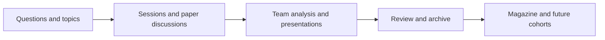

# SDA | Building a Data Analytics Community

[Portfolio](../README.md) · [한국어](sda-leadership.ko.md)

**Role:** Founder & President; session planning, community operations, website development 
**Project type:** Community leadership and AI-assisted web development 
**Explore:** [Website](https://ku-sda.com) · [Curriculum](https://ku-sda.com/curriculum) · [Project archive](https://ku-sda.com/archive) · [Magazine](https://ku-sda.com/magazine)

## Why I Started It

While studying data analysis on my own, I found it difficult to locate useful material and work through unfamiliar methods without people to discuss them with. I brought together students with similar interests and founded SDA at Korea University.

The club's full name is **Korea University Sports Data Analysis**. Sport provided a shared starting point; the learning activities centered on analytical methods, papers, and team projects. This case study focuses on building the organization and making its knowledge reusable.

## Outcomes

- Established a learning structure combining regular sessions, paper discussions, team analysis, and presentations.
- Connected the club's activities to a curriculum page, project archive, and magazine rather than leaving the work in one-off presentations.
- Organized third-cohort materials into **8 sessions and 20 public PDFs**, as recorded in the operating documentation. These are cohort-specific counts, not a count of all activities or materials authored solely by me.
- Separated membership approval, public profiles, publishing, and administrator permissions, with handover documentation for future organizers.

## My Role

| Area | My Contribution | Evidence |
|---|---|---|
| Community building | Recruited peers and defined the club's direction and operating structure | [Curriculum](https://ku-sda.com/curriculum) |
| Session planning | Prepared topics and materials covering analytical foundations, regression, classification, and clustering | Curriculum and session materials |
| Collaboration | Matched tasks to members' strengths and experience; consolidated ideas and results | [Team project archive](https://ku-sda.com/archive) |
| Knowledge management | Structured presentations and analyses so later members could find and reuse them | Archive and [magazine](https://ku-sda.com/magazine) |
| Website development | Used AI-assisted development to build the site and organize content and membership workflows | [Live website](https://ku-sda.com) |

Team analyses and magazine articles are collective work. My leadership role does not imply sole authorship of those outputs.

## What I Learned About Leadership

Members arrived with very different levels of analytical experience. A session could be too basic for one person and too difficult for another. Trying to resolve that tension alone made it harder to communicate the reasoning behind decisions.

I learned to share concerns and progress earlier, and to consider members' strengths when assigning work. Running a community meant more than meeting deadlines: it meant helping people understand their role and produce something they could build on together.

## Website & Operating System

| Component | Design |
|---|---|
| Public content | Curriculum, project and PDF archive, magazine, public member profiles |
| Internal workflows | Approved-member login, administrator roles, draft and publication management |
| Data separation | Membership approval records kept separate from public profiles |
| Stack | Next.js, React, TypeScript, Supabase Auth, PostgreSQL, Storage, Vercel |
| Continuity | Documented deployment, publishing, membership management, and access handover |

I also built an internal competition module with CSV submissions, automated scoring, and a leaderboard. **That module was retired in September 2026** and is presented as past implementation experience, not a current feature.

## Scope & Transferable Skills

The operating repository remains private. The live site and public materials demonstrate the outputs without exposing member records or administrative information. Operating documentation is not a substitute for a security audit.

The experience developed my approach to scheduling, information management, communication, publication boundaries, and handover. I do not claim unmeasured gains in efficiency or user growth.

**Source materials:** Website content and operating materials are primarily in Korean.
