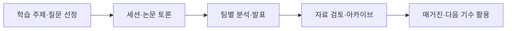

# SDA | 학술 커뮤니티 운영을 기록과 시스템으로 연결하기

**역할:** 창립자·회장 / 세션 기획·조직 운영 / 공식 웹사이트 구축 
**형태:** 공동체 운영 및 AI 보조 웹 개발 
**바로 보기:** [공식 홈페이지](https://ku-sda.com) · [활동 안내](https://ku-sda.com/curriculum) · [프로젝트 아카이브](https://ku-sda.com/archive) · [매거진](https://ku-sda.com/magazine)

## 왜 시작했나

혼자 데이터 분석을 공부하면서 자료를 찾고 방법을 이해하는 데 어려움을 느꼈습니다. 함께 질문하고 결과를 비교할 동료가 필요해, 관심 있는 학생들을 모아 고려대학교 학술동아리 SDA를 만들었습니다. 스포츠를 공통 관심사로 삼되, 활동은 데이터 분석 학습과 프로젝트 수행을 중심으로 설계했습니다.

정식 명칭은 **Korea University Sports Data Analysis**입니다. 이 사례에서는 특정 종목보다 조직을 만들고 운영하며 지식을 축적한 경험에 초점을 맞춥니다.

## 핵심 결과

- 정규 세션, 논문 토론, 팀별 분석과 발표가 이어지는 학습·운영 구조를 만들었습니다.
- 활동과 결과물이 일회성 발표에 그치지 않도록 홈페이지의 활동 안내·아카이브·매거진으로 연결했습니다.
- 운영 기록상 3기 세션 자료는 **8회차·공개 PDF 20개**로 정리되어 있습니다. 이 수치는 전체 활동 횟수나 모든 자료의 개인 저작량을 뜻하지 않습니다.
- 회원 승인, 공개 프로필, 콘텐츠 발행과 운영 권한을 구분하고, 다음 운영진을 위한 인수인계 문서를 마련했습니다.

## 내 역할

| 영역 | 맡은 일 | 확인할 수 있는 결과 |
|---|---|---|
| 조직 기획 | 함께 공부할 구성원을 모으고 활동 방향과 운영 방식을 구성 | [활동 안내](https://ku-sda.com/curriculum) |
| 세션 운영 | 데이터 분석 기초, 회귀·분류·군집화 등 학습 주제와 세션 자료 준비 | 활동 안내 및 세션 자료 |
| 협업 | 구성원의 강점과 숙련도를 살펴 역할을 나누고, 팀의 아이디어와 결과를 취합 | [팀 프로젝트 아카이브](https://ku-sda.com/archive) |
| 정보 관리 | 발표·분석 자료를 다음 사람이 찾고 활용할 수 있도록 구조화 | 아카이브와 [매거진](https://ku-sda.com/magazine) |
| 시스템 구축 | AI 보조 도구를 활용해 홈페이지를 구축하고 콘텐츠·회원 관리 흐름을 정리 | [운영 중인 사이트](https://ku-sda.com) |

SDA의 팀 분석과 매거진은 구성원들의 공동 결과물입니다. 회장이라는 이유로 모든 분석·원고를 개인 성과로 설명하지 않습니다.

## 운영하면서 배운 점

가장 어려웠던 문제는 구성원마다 데이터 분석 경험이 다르다는 점이었습니다. 같은 세션도 누구에게는 쉽고 누구에게는 어려웠고, 이 조율을 혼자 고민하면 의도가 충분히 전달되지 않았습니다. 이후에는 고민과 진행 상황을 더 일찍 공유하고, 각자의 강점을 고려해 역할을 나누려 노력했습니다.

이 경험을 통해 운영은 일정을 지키는 것에 더해, 구성원이 무엇을 해야 하는지 이해하고 결과를 함께 남길 수 있도록 돕는 일이라는 점을 배웠습니다.

## 웹사이트와 운영 체계

| 구분 | 설계 내용 |
|---|---|
| 공개 콘텐츠 | 활동 안내, 프로젝트·PDF 아카이브, 매거진, 공개 멤버 프로필 |
| 내부 운영 | 승인된 회원의 로그인, 관리자 권한, 초안·발행 관리 |
| 데이터 구분 | 로그인 승인 정보와 외부 공개 프로필을 별도로 관리 |
| 기술 | Next.js, React, TypeScript, Supabase Auth·PostgreSQL·Storage, Vercel |
| 운영 지속성 | 배포·자료 게시·멤버 운영·권한 인수인계 절차 문서화 |

과거에는 CSV 제출·자동 채점·리더보드를 갖춘 내부 경진대회 모듈도 구축했습니다. **이 모듈은 2026년 9월 종료되었으며 현재 서비스 기능으로 소개하지 않습니다.** 현재는 학습 기록과 분석 콘텐츠를 축적하는 기능을 중심으로 운영합니다.

## 공개 범위와 업무 연결

운영 저장소는 비공개로 유지합니다. 소스 전체나 회원 명단을 공개하는 대신 실제 사이트와 공개 자료로 결과를 확인할 수 있게 했습니다. 운영 문서의 존재는 권한 통제의 완전한 보안 감사나 운영 사고 부재를 의미하지 않습니다.

이 경험은 일정·자료 관리, 여러 사람과의 의사소통, 정보 공개 범위 구분, 담당자 변경에 대비한 인수인계 역량과 연결됩니다. 운영 효율 개선율이나 이용자 수는 별도 측정 없이 제시하지 않습니다.

[전체 포트폴리오로 돌아가기](../README.md)
