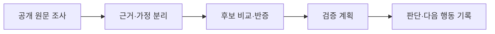

# AI 조사 도구 | 정보의 출처와 판단 과정을 남기는 워크플로

**한국어** | [English](startup-intelligence.md)

**형태:** 개인용 Codex 플러그인 / AI 보조 개발 
**공개 버전:** 0.8.2 
**바로 보기:** [코드·설치 방법](https://github.com/jameshui0228/korea-startup-intelligence-team-marketplace) · [사용 예제](https://github.com/jameshui0228/korea-startup-intelligence-team-marketplace/blob/main/docs/portfolio-demo.ko.md)

## 문제

창업 아이디어나 시장 정보를 조사하면 출처, 해석, 아직 확인하지 않은 가정이 한 문서에 섞이기 쉽습니다. 다시 조사할 때 무엇을 확인했고 왜 보류했는지 알기 어렵다는 문제를 도구로 정리하고자 했습니다.

## 핵심 결과

- 공개 원문을 조사하는 Codex 작업과, 근거·후보·검증 이력을 저장하는 Python 도구를 연결했습니다.
- 사실, 추론, 가정, 미확인 내용을 나눠 관리하고, 지지 근거뿐 아니라 반대 근거와 다음 확인 과제도 기록하도록 구성했습니다.
- 후보 탐색에서 검증 계획, 시간·예산, 진행·보류 상태까지 이어지는 작업 흐름을 만들었습니다.
- 2026-10-13, Python 3.13 로컬 환경에서 기존 **586개 테스트 통과**를 확인했습니다. 이는 소프트웨어 동작 검증이며 사업성·수익성 검증이 아닙니다.

## 내 역할

필요한 조사·관리 흐름을 정의하고, AI 보조 도구와 함께 플러그인을 구현·개선해 공개 저장소로 배포했습니다. 작업의 초점은 별도 예측 모델을 학습하는 것보다, **조사 과정에서 무엇을 저장하고 어떤 조건에서 다음 단계로 넘길지**를 구조화하는 데 있습니다.

| 설계 항목 | 구현에서 확인할 수 있는 부분 |
|---|---|
| 근거 추적 | [주장별 근거 관리 코드](https://github.com/jameshui0228/korea-startup-intelligence-team-marketplace/blob/main/plugins/korea-startup-intelligence/scripts/ksi_lib/claim_ledger.py) |
| 데이터·상태 관리 | [SQLite 저장 계층](https://github.com/jameshui0228/korea-startup-intelligence-team-marketplace/blob/main/plugins/korea-startup-intelligence/scripts/ksi_lib/model.py) |
| 사용자 작업 흐름 | [CLI 진입점](https://github.com/jameshui0228/korea-startup-intelligence-team-marketplace/blob/main/plugins/korea-startup-intelligence/scripts/ksi.py) |
| 검증 | [기능별 테스트](https://github.com/jameshui0228/korea-startup-intelligence-team-marketplace/tree/main/plugins/korea-startup-intelligence/tests) |
| 구현 범위 관리 | [요구사항별 구현·대기 상태](https://github.com/jameshui0228/korea-startup-intelligence-team-marketplace/blob/main/plugins/korea-startup-intelligence/ACCEPTANCE_76.md) |

## 실행과 확인

설치 없이도 저장소를 내려받아 Python 표준 라이브러리만으로 별도의 임시 작업공간을 만들고 명령을 실행할 수 있습니다. [오프라인 사용 예제](https://github.com/jameshui0228/korea-startup-intelligence-team-marketplace/blob/main/docs/portfolio-demo.ko.md)는 네트워크·API 키 없이 구조화된 조사 질문이 생성되는지 확인하는 경로입니다.

이 예제는 실제 시장조사를 완료한 결과가 아닙니다. 실제 조사에는 원문 접근과 검토가 필요합니다. 확인한 자료가 없을 때 이를 검증된 시장 기회로 표시하지 않는 것이 설계 원칙입니다.

## 한계와 업무 연결

- 사업 성공률, 투자 수익, 조사 시간 절감률은 실측하지 않았으므로 제시하지 않습니다.
- 테스트 통과는 외부 서비스 연결이나 모든 실제 사용 상황의 성공을 보장하지 않습니다.
- 외부 연락·게시·지출을 자동 실행하는 도구가 아닙니다.
- 기업·시장 조사 보조, 근거 정리, 후속 업무 관리로 확장할 수 있지만 투자 판단을 대신하는 시스템은 아닙니다.

**기술:** Python, SQLite, CLI, unittest, Codex 플러그인, AI 보조 개발

[전체 포트폴리오로 돌아가기](../README.ko.md)
