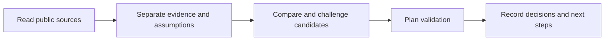

# Evidence-Tracked AI Research Tool

[Portfolio](../README.md) · [한국어](startup-intelligence.ko.md)

**Project type:** Personal Codex plugin; AI-assisted development 
**Public version:** 0.8.2 
**Explore:** [Code and installation](https://github.com/jameshui0228/korea-startup-intelligence-team-marketplace) · [Offline demo](https://github.com/jameshui0228/korea-startup-intelligence-team-marketplace/blob/main/docs/portfolio-demo.md)

## The Problem

Research notes can mix source material, interpretation, and untested assumptions in the same document. When revisiting an idea, it becomes difficult to tell what was actually checked and why a decision was deferred.

I built a tool to make that research process explicit and reviewable.

## Outcomes

- Connected Codex-led research of public sources to Python tooling that stores evidence, candidate ideas, and validation history.
- Separated facts, inferences, assumptions, and unknowns, while recording counterevidence and follow-up questions.
- Linked candidate exploration to validation plans, time and budget constraints, and proceed or hold decisions.
- Verified **586 existing tests passing** locally with Python 3.13 on 2026-10-13. These tests check software behavior, not commercial viability or investment performance.

## My Role

I defined the research and tracking workflow, implemented and refined the plugin with AI assistance, and published it in a public repository. The emphasis was not training a predictive model, but designing **what to record and what evidence is needed before moving to the next stage**.

| Design Area | Implementation Evidence |
|---|---|
| Evidence tracking | [Claim ledger](https://github.com/jameshui0228/korea-startup-intelligence-team-marketplace/blob/main/plugins/korea-startup-intelligence/scripts/ksi_lib/claim_ledger.py) |
| Data and state management | [SQLite storage layer](https://github.com/jameshui0228/korea-startup-intelligence-team-marketplace/blob/main/plugins/korea-startup-intelligence/scripts/ksi_lib/model.py) |
| User workflow | [CLI entry point](https://github.com/jameshui0228/korea-startup-intelligence-team-marketplace/blob/main/plugins/korea-startup-intelligence/scripts/ksi.py) |
| Testing | [Feature-level tests](https://github.com/jameshui0228/korea-startup-intelligence-team-marketplace/tree/main/plugins/korea-startup-intelligence/tests) |
| Scope management | [Implemented and pending requirements, Korean](https://github.com/jameshui0228/korea-startup-intelligence-team-marketplace/blob/main/plugins/korea-startup-intelligence/ACCEPTANCE_76.md) |

## Try It Without Credentials

The [offline demo](https://github.com/jameshui0228/korea-startup-intelligence-team-marketplace/blob/main/docs/portfolio-demo.md) uses the Python standard library to initialize a temporary workspace and generate structured research questions. It makes no network requests and requires no API keys.

This is a workflow demonstration, not completed market research. Reviewing original sources and linking evidence are separate steps. Questions without reviewed sources remain explicitly unverified.

## Scope & Limitations

- Business success rates, investment returns, and research time savings have not been measured.
- Passing tests do not establish the availability of every external service or cover every real-world use case.
- The tool does not autonomously contact third parties, publish content, or spend money.
- The workflow can support company and market research, evidence organization, and follow-up tracking; it does not replace investment judgment.

**Tools:** Python, SQLite, CLI, unittest, Codex plugins, AI-assisted development.

**Language:** This case study and the public demo guide are in English. The underlying research prompts and detailed user documentation are primarily in Korean.
